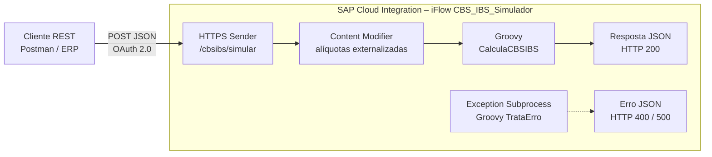

# Simulador CBS/IBS – SAP Cloud Integration (CPI)

iFlow de estudo no **SAP Integration Suite** que recebe um documento fiscal simplificado via REST, valida os itens e calcula **CBS** e **IBS** (Reforma Tributária – LC 214/2025) com alíquotas parametrizáveis.

> **Aviso:** projeto de portfólio para estudo. A base de cálculo é simplificada e não substitui o cálculo fiscal oficial.

*English summary: SAP CPI integration flow that receives a simplified invoice via REST, validates it and simulates the new Brazilian consumption taxes (CBS/IBS) with externalized parameters and standardized error handling.*

---

## Arquitetura



## O que este projeto demonstra

| Competência | Onde |
|---|---|
| HTTPS sender adapter com OAuth 2.0 (client credentials) | Etapas 3 e 5 do passo a passo |
| Parâmetros externalizados (`{{ALIQUOTA_CBS}}`) | Content Modifier |
| Groovy: parse de JSON, validação, `BigDecimal`, arredondamento fiscal | `src/scripts/CalculaCBSIBS.groovy` |
| Tratamento de erro padronizado (400 x 500) | `src/scripts/TrataErro.groovy` |
| Log de payload no monitoramento (MPL attachments) | parâmetro `LOG_PAYLOAD` |
| Testes locais dos scripts, sem tenant | `test/RodarTestes.groovy` |

## Exemplo

**Requisição** (`test/payloads/request_ok.json`):
```json
{
  "documento": { "numero": "000123", "serie": "1", "ufOrigem": "SP", "ufDestino": "RJ" },
  "itens": [
    { "item": 1, "ncm": "84713012", "descricao": "Notebook 14 polegadas", "quantidade": 2, "valorUnitario": 4500.00, "desconto": 200.00 },
    { "item": 2, "ncm": "85176277", "descricao": "Roteador Wi-Fi", "quantidade": 3, "valorUnitario": 389.90 }
  ]
}
```

**Resposta** (alíquotas de exemplo: CBS 0,9% e IBS 0,1%):
```json
"totais": {
  "baseCalculo": 9969.70,
  "valorCBS": 89.73,
  "valorIBS": 9.97,
  "valorTotalTributos": 99.70
}
```

**Erro de validação** (HTTP 400):
```json
{
  "status": 400,
  "erro": "REQUISICAO_INVALIDA",
  "mensagem": "itens[0].ncm deve ter 8 dígitos numéricos (recebido: '8471')."
}
```

## Regras de cálculo

| Regra | Implementação |
|---|---|
| Base de cálculo do item | quantidade × valor unitário − desconto |
| CBS / IBS do item | base × alíquota ÷ 100, arredondado em 2 casas (HALF_UP) |
| Totais | soma dos valores já arredondados por item |
| Validações | documento.numero obrigatório; ao menos 1 item; NCM com 8 dígitos; quantidade > 0; valores ≥ 0; desconto ≤ valor do item |

## Estrutura

```
├── src/scripts/          Scripts Groovy usados no iFlow
├── test/payloads/        JSONs de teste (sucesso e erro)
├── test/RodarTestes.groovy  Testes locais (12 verificações)
├── test/mock/            Mock da classe Message do CPI
├── docs/passo-a-passo-iflow.md  Como montar o iFlow no trial
├── docs/img/             Prints do tenant
└── iflow/                Export (.zip) do iFlow
```

## Como rodar os testes localmente

Requer Groovy 3 ou superior:
```bash
groovyc -d build test/mock/com/sap/gateway/ip/core/customdev/util/Message.groovy
groovy -cp build test/RodarTestes.groovy
```

## Evidências (tenant SAP BTP trial)

**iFlow no Integration Suite**


**Parâmetros externalizados (Configure)**


**Sucesso – HTTP 200, total de tributos R$ 99,70**


**Erro de validação – HTTP 400 (NCM com 4 dígitos)**


**Monitoramento – anexos de entrada e saída no Message Processing Log**
| Entrada | Saída |
|---|---|
|  |  |

## Próximas evoluções

- [ ] Receber o XML da NF-e e converter para JSON (Message Mapping / XSLT)
- [ ] Alíquotas por NCM via Value Mapping
- [ ] Gravar o histórico de simulações no Data Store

## Autora

**Adriana Vital dos Santos** – Consultora SAP BTP | Integration Suite (CPI) | SAP Certified Integration Developer
[LinkedIn](https://www.linkedin.com/in/SEU-PERFIL)
