# Simulador CBS/IBS – SAP Cloud Integration (CPI)

Integração de estudo no **SAP Integration Suite** que recebe documentos fiscais via REST (**JSON ou XML da NF-e**), valida os itens e calcula **CBS** e **IBS** (Reforma Tributária – LC 214/2025), com **alíquotas por NCM** mantidas em Value Mapping, **histórico** de cada simulação gravado no Data Store e a API publicada no **SAP API Management** com **rate limit**.

> **Aviso:** projeto de portfólio para estudo. A base de cálculo é simplificada e as alíquotas são didáticas; não substitui o cálculo fiscal oficial.

*English summary: SAP CPI integration that receives invoices via REST (JSON or Brazilian NF-e XML), validates them and simulates the new Brazilian consumption taxes (CBS/IBS). Features XSLT mapping, NCM-based rates via Value Mapping, Data Store history with lookup API, API Management proxy with quota policy, externalized parameters and standardized HTTP error handling (400/404/415/500).*

---

## Arquitetura

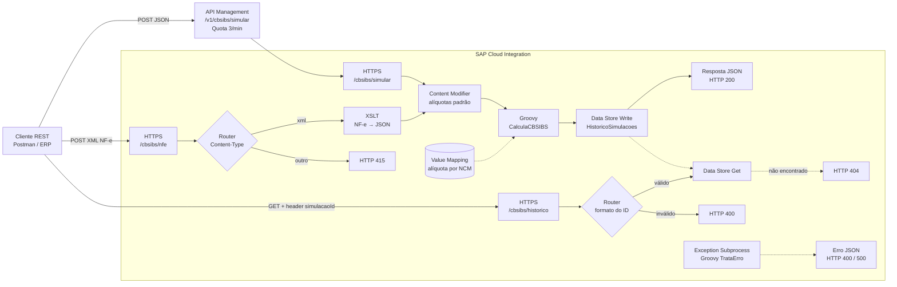

| Artefato no CPI | Tipo | Endpoint / uso |
|---|---|---|
| `CBS_IBS_Simulador` | Integration Flow | `POST /cbsibs/simular` (JSON) + grava histórico |
| `CBS_IBS_Simulador_NFe` | Integration Flow | `POST /cbsibs/nfe` (XML da NF-e) |
| `CBS_IBS_Historico` | Integration Flow | `GET /cbsibs/historico` (header `simulacaoId`) |
| `VM_Aliquotas_NCM` | Value Mapping | Alíquotas CBS/IBS por NCM |
| `CBS_IBS_Simulador_API` | API Proxy (API Management) | `POST /v1/cbsibs/simular` com policy Quota (3 chamadas/min) |

## O que este projeto demonstra

| Competência | Onde |
|---|---|
| HTTPS sender adapter com autenticação por client credentials | Todos os iFlows |
| Parâmetros externalizados (`{{ALIQUOTA_CBS}}`) | Content Modifier |
| Groovy: parse de JSON, validação, `BigDecimal`, arredondamento fiscal | `src/scripts/CalculaCBSIBS.groovy` |
| **XSLT 2.0** com namespace da NF-e, gerando JSON | `src/mappings/NFe_para_JSON.xsl` |
| **Value Mapping** consultado via `ValueMappingApi` com fallback para o padrão | `CalculaCBSIBS.groovy` + `VM_Aliquotas_NCM` |
| **Data Store** Write/Get com chave de negócio, retenção e criptografia | `CBS_IBS_Simulador` e `CBS_IBS_Historico` |
| Tratamento de erro padronizado (400 x 500) | `src/scripts/TrataErro.groovy` |
| **Router** validando `Content-Type` (HTTP 415) e formato do ID por regex (HTTP 400) | `CBS_IBS_Simulador_NFe` e `CBS_IBS_Historico` |
| **Exception Subprocess** devolvendo 404 para ID inexistente | `CBS_IBS_Historico` |
| **SAP API Management**: API Proxy + policy **Quota** distribuída | `CBS_IBS_Simulador_API` |
| Log de payload controlado por parâmetro (memória e LGPD) | parâmetro `LOG_PAYLOAD` |
| Testes locais dos scripts e do XSLT, sem tenant | `test/RodarTestes.groovy` (23 verificações) |

## Exemplos

**JSON** (`test/payloads/request_value_mapping.json`): 3 itens, um deles com alíquota reduzida via Value Mapping.
```json
"itens": [
  { "item": 1, "ncm": "84713012", "baseCalculo": 8800.00, "aliquotaCBS": 0.9,  "origemAliquota": "VALUE_MAPPING", "valorCBS": 79.20 },
  { "item": 2, "ncm": "85176277", "baseCalculo": 1169.70, "aliquotaCBS": 0.9,  "origemAliquota": "PADRAO",        "valorCBS": 10.53 },
  { "item": 3, "ncm": "30049099", "baseCalculo": 250.00,  "aliquotaCBS": 0.36, "origemAliquota": "VALUE_MAPPING", "valorCBS": 0.90 }
],
"totais": { "baseCalculo": 10219.70, "valorCBS": 90.63, "valorIBS": 10.07, "valorTotalTributos": 100.70 }
```

**XML da NF-e** (`test/payloads/nfe_exemplo.xml`, layout 4.00 fictício) → mesmo cálculo, com a chave de acesso preservada:
```json
"documento": { "chaveAcesso": "35261012345678000195550010000001231000001230", "numero": "123", "ufOrigem": "SP", "ufDestino": "RJ" }
```

**Histórico:** cada resposta traz um `idSimulacao` (ex.: `SIM-000125-20261021193344938`), que é a chave no Data Store e pode ser consultada depois em `GET /cbsibs/historico`.

**Erros padronizados:**

| HTTP | Quando | Exemplo de `erro` |
|---|---|---|
| 400 | Dados inválidos (NCM, JSON, ID do histórico) | `REQUISICAO_INVALIDA` / `ID_INVALIDO` |
| 404 | Simulação não encontrada no Data Store | `SIMULACAO_NAO_ENCONTRADA` |
| 415 | Endpoint NF-e chamado sem `Content-Type` XML | `TIPO_NAO_SUPORTADO` |
| 500 | Falha de configuração (ex.: alíquota ausente) ou quota excedida no gateway | `ERRO_PROCESSAMENTO` / `policies.ratelimit.QuotaViolation` |

## Regras de cálculo

| Regra | Implementação |
|---|---|
| Base de cálculo do item | quantidade × valor unitário − desconto |
| Alíquota do item | Value Mapping por NCM; se não houver, alíquota padrão do Content Modifier |
| CBS / IBS do item | base × alíquota ÷ 100, arredondado em 2 casas (HALF_UP) |
| Totais | soma dos valores já arredondados por item |
| Validações | documento.numero obrigatório; ao menos 1 item; NCM com 8 dígitos; quantidade > 0; valores ≥ 0; desconto ≤ valor do item |

## Decisões técnicas

| Decisão | Motivo |
|---|---|
| XSLT em vez de Message Mapping | Saída em JSON e XSD da NF-e grande e com namespace; o XSLT é texto, versionável e testável localmente |
| Endpoint separado para XML | Não altera o iFlow JSON que já estava em produção |
| Value Mapping em vez de parâmetro | Tabela mantida pela área fiscal sem alterar nem reimplantar o iFlow |
| Chave de negócio no Data Store | ID gerado (`SIM-<numero>-<timestamp>`) permite consulta; sem ele o CPI gera UUID impossível de rastrear |
| Data Store com expiração de 30 dias e criptografia | Histórico curto e LGPD; para longo prazo, usar banco (HANA Cloud) |
| Router antes do XSLT (415) | Valida o contrato cedo; formato errado não chega a quebrar o mapeamento |
| 400 x 404 no histórico | Regex no Router separa ID mal formado (erro do chamador) de ID inexistente (Exception Subprocess) |
| Quota em vez de Spike Arrest | Spike Arrest suaviza picos por servidor e não bloqueou de forma previsível no ambiente distribuído; Quota distribuída conta de forma centralizada |

## Estrutura

```
├── src/scripts/                 Scripts Groovy (cálculo e tratamento de erro)
├── src/mappings/                XSLT NF-e → JSON
├── test/payloads/               JSON e XML de teste (sucesso e erro)
├── test/mock/                   Mocks das APIs do CPI (Message, ValueMappingApi)
├── test/RodarTestes.groovy      Testes locais (23 verificações)
├── docs/passo-a-passo-iflow.md  Como montar o iFlow base no trial
├── docs/evolucoes.md            Como montar as evoluções e as melhorias
├── docs/img/                    Prints do tenant
├── iflow/                       Export (.zip) do pacote do CPI
└── apim/                        Export (.zip) do API Proxy
```

## Como rodar os testes localmente

Requer Groovy 3 ou superior:
```bash
groovyc -d build $(find test/mock -name "*.groovy")
groovy -cp build test/RodarTestes.groovy
```

## Evidências (tenant SAP BTP trial)

### Versão base – JSON

**iFlow**
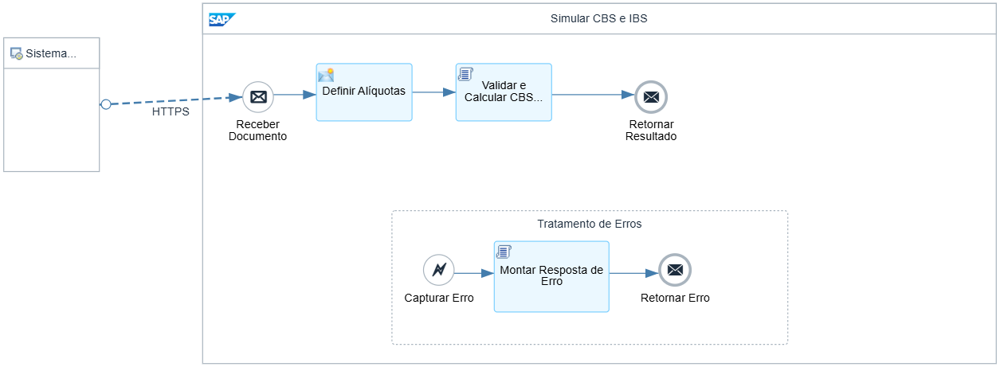

**Parâmetros externalizados**
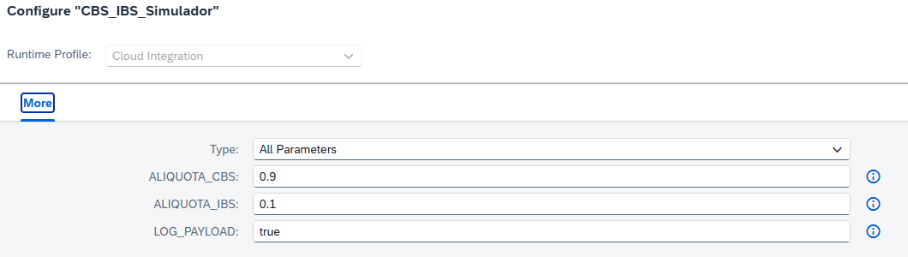

**Sucesso – HTTP 200, total de tributos R$ 99,70**
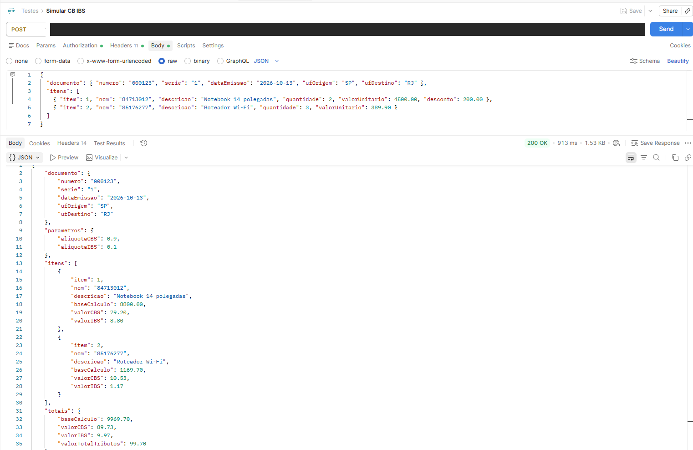

**Erro de validação – HTTP 400**
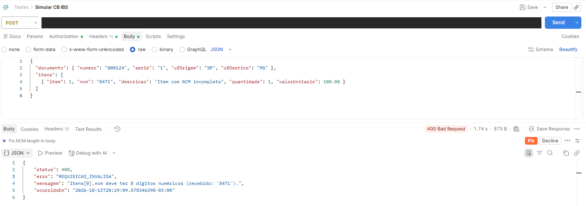

**Monitoramento – anexos de entrada e saída**
| Entrada | Saída |
|---|---|
| 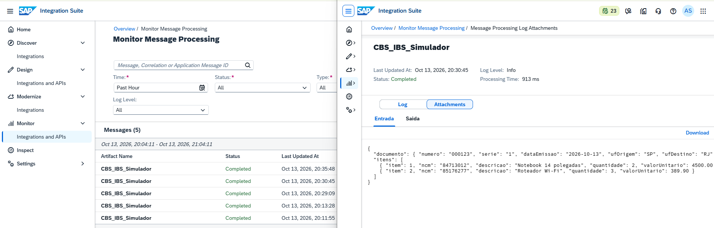 | 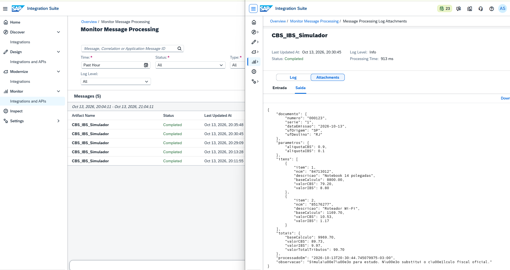 |

### Evolução 1 – XML da NF-e com XSLT

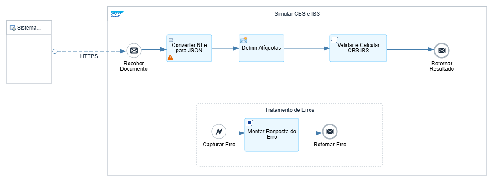
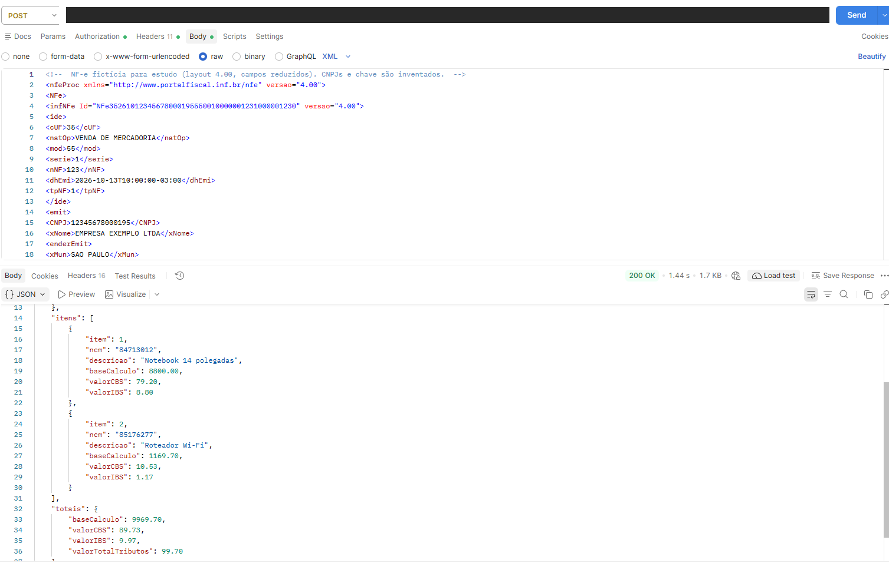

### Evolução 2 – Alíquotas por NCM com Value Mapping

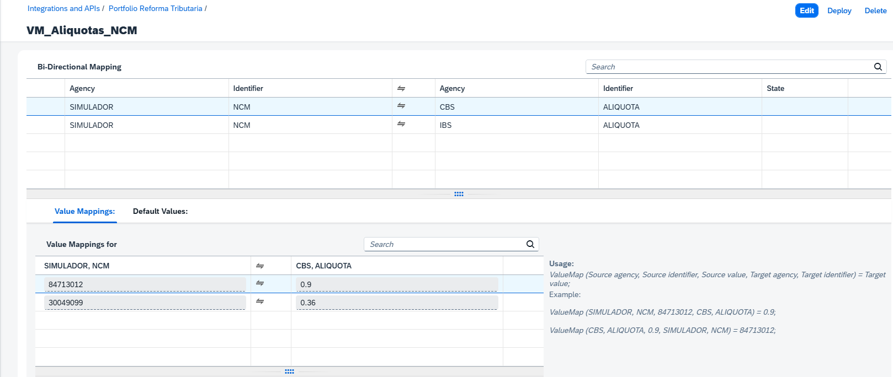
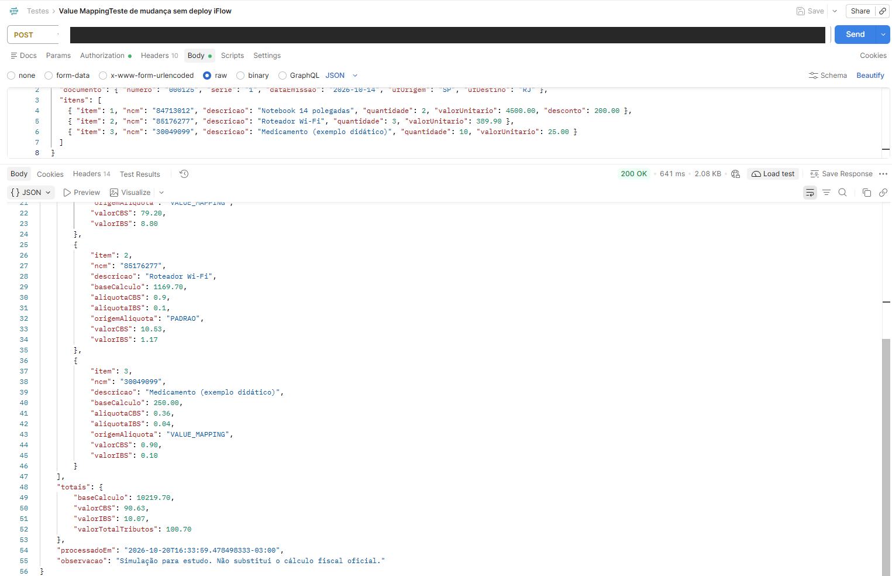

### Evolução 3 – Histórico no Data Store

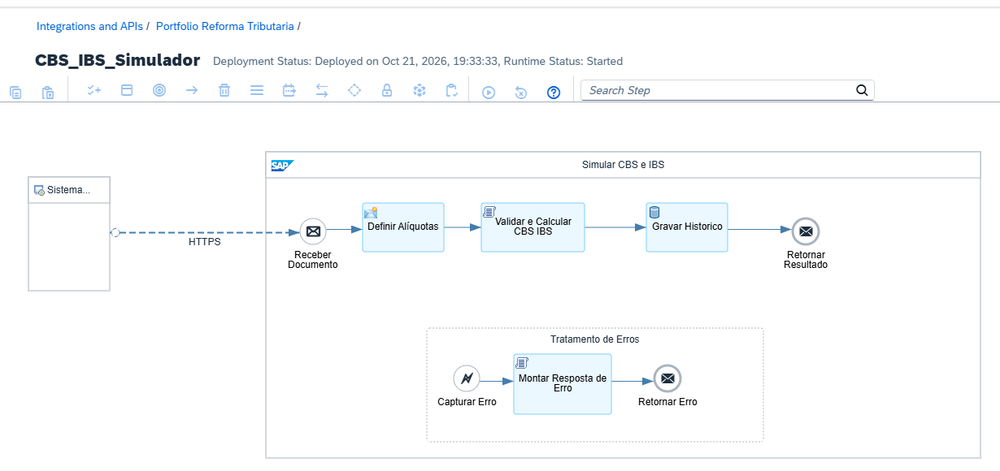
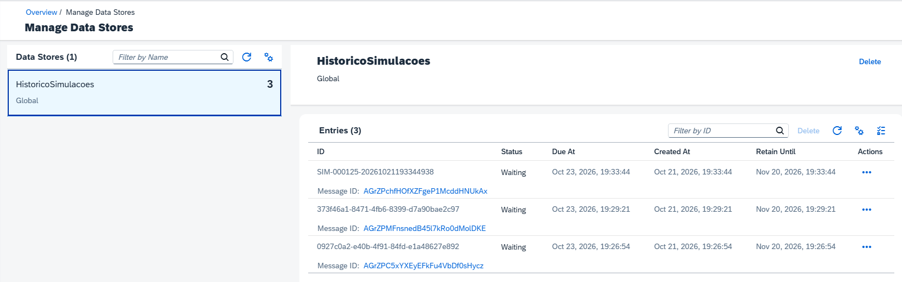
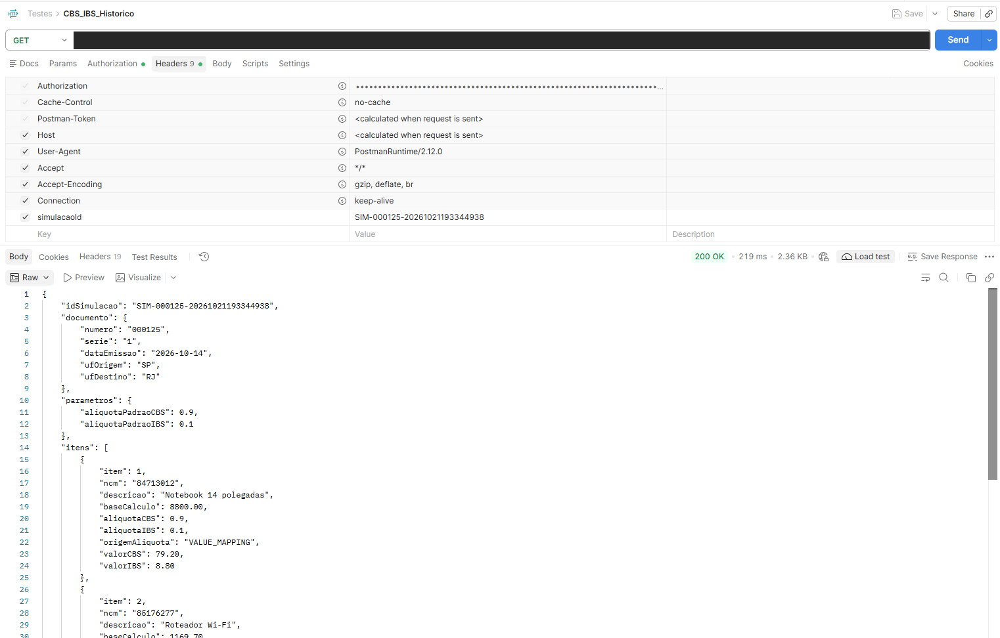

### Melhoria 1 – Router validando Content-Type (HTTP 415)

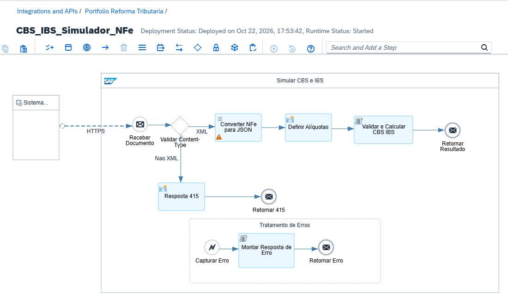
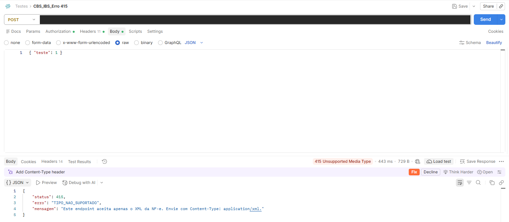

### Melhoria 2 – Histórico com 400 e 404

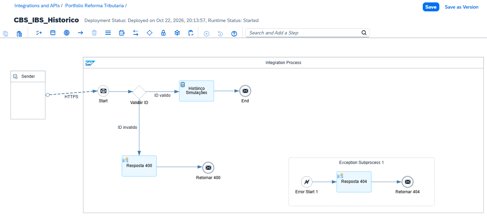
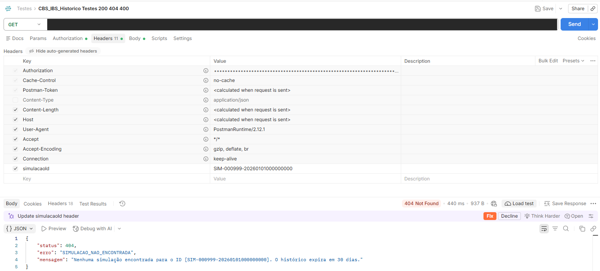

### Melhoria 3 – SAP API Management com rate limit

**Chamada pelo proxy** (`/v1/cbsibs/simular`) – HTTP 200
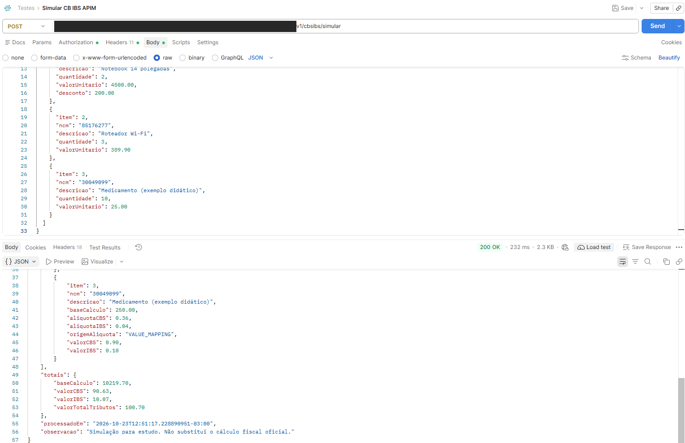

**Policy Quota** (3 chamadas por minuto, distribuída)
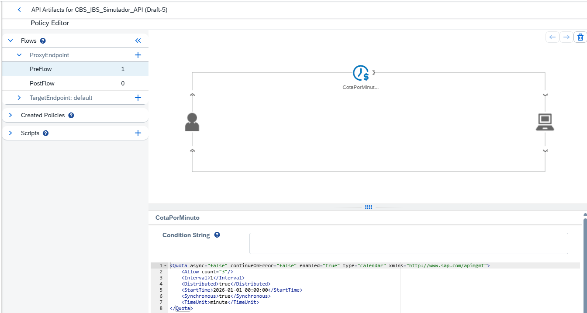

**4ª chamada no mesmo minuto bloqueada no gateway**
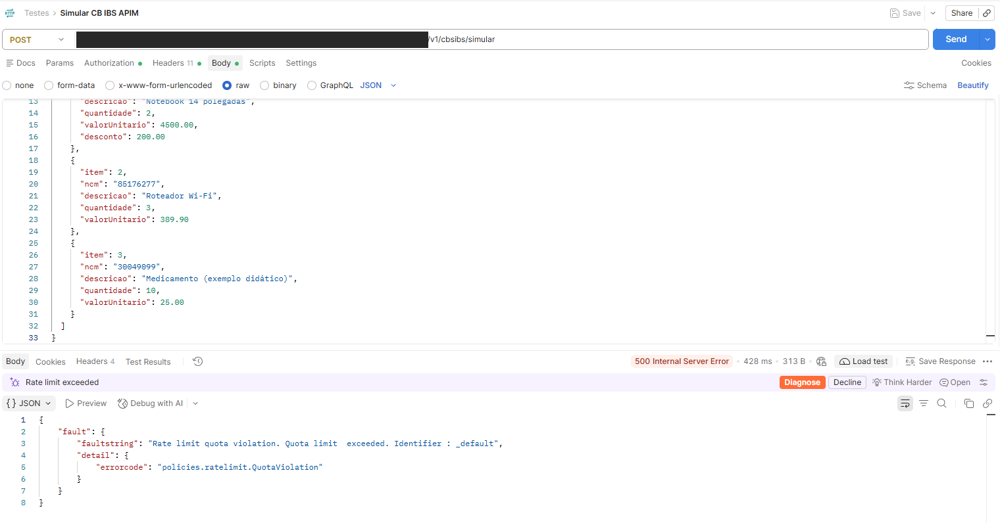

## Integrações adicionais (outros protocolos SAP)

Além do cenário CBS/IBS, este repositório inclui iFlows avulsos para demonstrar protocolos de integração comuns em projetos SAP que não aparecem no simulador fiscal:

| Protocolo | iFlow | Detalhe |
|---|---|---|
| **OData V2** | `SF_EmployeeCentral_OData` | Consome uma API real do **SuccessFactors Employee Central** (sandbox do SAP Business Accelerator Hub) — [documentação completa](integracoes-sap/successfactors-odata/README.md) |
| **SOAP** | `Calculadora_SOAP` | Consome um web service **SOAP 1.1 via WSDL** com o SOAP Adapter nativo do CPI — [documentação completa](integracoes-sap/calculadora-soap/README.md) |
| JMS (assíncrono) | *em andamento* | — |

## Roadmap

- [x] Receber o XML da NF-e e converter para JSON (XSLT)
- [x] Alíquotas por NCM via Value Mapping
- [x] Gravar o histórico de simulações no Data Store e consultar por ID
- [x] Router validando `Content-Type` no endpoint NF-e (HTTP 415)
- [x] Exception Subprocess no iFlow de histórico (HTTP 404 para ID inexistente)
- [x] Publicar a API no SAP API Management com policy de rate limit
- [x] Converter a violação de quota em HTTP 429 (Raise Fault)
- [x] Validar o XML da NF-e contra o XSD (XML Validator)
- [x] Verify API Key por consumidor e produto no Developer Hub
- [x] Consumir API OData do SAP SuccessFactors (Employee Central)
- [x] Consumir um serviço SOAP
- [ ] Endpoint assíncrono com JMS

## Autora

**Adriana Vital dos Santos** – Consultora SAP Integration Suite (CPI) | SAP Certified Integration Developer
[LinkedIn](https://www.linkedin.com/in/adrianavsantos/)
